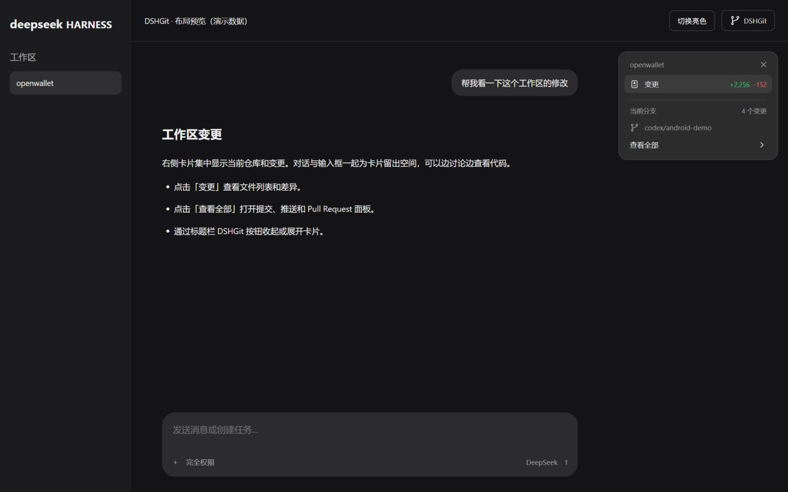
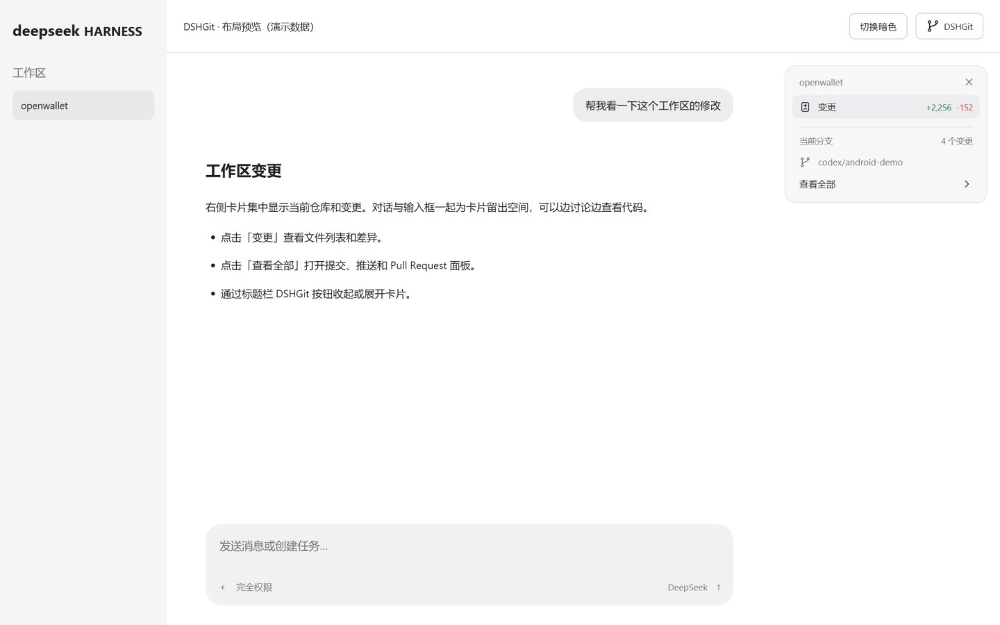

# DSHGit

> 2026-10-25：已适配 DSH **0.2.1-rc.3**，保留原有旧版范围。统一策略、安装版本和验证边界见 [rc.3 兼容记录](../docs/dsh-0.2.1-rc.3.md)。

当前版本已适配 **DSH 0.2.1-rc.2**，开发依赖锁定到该版本。2026-10-18 已完成本地构建与接口测试；真实桌面交互由用户手动验收。下文较早版本的验证记录保留为历史证据。

面向 **DeepSeek Harness 0.2.1-rc.2** 的原生 Git 面板插件。Web 与桌面 Web 客户端共用同一界面；插件不依赖本仓库的其他组件。

会话右上方默认显示紧凑的 **DSHGit 工作区卡片**，标题栏的 **DSHGit** 按钮可收起或展开。会话容器宽度达到 900px 时，右侧预留 328px，消息和输入框一起左移；窄窗口自动收起，可手动展开为悬浮卡片，不压缩正文。点击「变更」或「查看全部」打开详细操作面板：

- **变更卡片**：工作区名称、文件数、增删行数；点击变更查看已暂存和未暂存文件，支持逐文件暂存、取消暂存、文本差异查看。
- **提交与推送**：分支切换、创建功能分支、提交信息、包含未暂存更改选项，以及提交、提交并推送、创建 Pull Request、单独推送四个入口。提交信息留空时，由当前会话模型根据本次暂存差异生成，再执行提交。单独推送已有提交不调用模型。
- **Pull Request**：查询当前分支已有的开放 PR 并打开；创建界面包含目标分支、标题、描述和草稿开关。标题或描述留空时，由当前会话模型补全，已填内容保持不变。创建前检查当前 HEAD 已推送到 origin。
- **主题一致性**：颜色直接引用 DSH 的 `--dsw-alias-*` 变量，随宿主亮色、暗色和跟随系统设置自动切换；不另存独立主题。独立开发预览使用系统颜色作为后备。
- **快捷键**：提交菜单内 `Ctrl/⌘+Enter` 提交，`Ctrl/⌘+Shift+Enter` 提交并推送；`Esc` 先关闭提交菜单，再关闭面板。入口还提供 HTML `accesskey=g`，具体修饰键由浏览器/操作系统决定。

## 安装

要求 Node.js **24+**、Git，以及 DSH 0.2.1-alpha.2。推送沿用宿主的 Git/SSH 凭证；PR 功能另需安装 [GitHub CLI](https://cli.github.com/) 并在宿主上完成 `gh auth login`。当前 PR 支持 `github.com` 的 `origin`，不支持其他托管平台及企业域名。

仓库包含可直接安装的 `lib/` 构建产物。将路径替换为实际绝对路径：

```powershell
dsh plugin --profile web add "link:C:/path/to/better-dsh/DSHGit" --ignore-scripts
```

桌面版请完整退出后，用桌面运行时附带的 `dsh` 命令安装，将 `web` 改为 `desktop`，然后重启。安装完成后在有工作区的会话标题栏打开 **DSHGit**。

## 操作约定

`main/master` 禁止提交、推送和创建 PR；可在提交菜单创建功能分支。插件不提供丢弃文件、强推、改写历史或合并 PR 操作。取消暂存只修改索引，不删除工作区文件。

“包含未暂存的更改”默认勾选，会暂存整个仓库下所有未忽略的新增、修改和删除；取消勾选时只提交现有暂存区。留空字段的生成使用 DSH 当前会话选择的模型和现有凭证，把相关差异发送给该模型提供方；已填写的字段不改写。模型调用仅生成文本，不具备工具执行能力，也不向当前对话插入消息。

PR 自动说明会先读取 origin 上目标分支，再总结该分支与当前提交的差异和提交记录。输入过长时会截断并明确标注；无测试执行证据时不声称测试通过。模型失败、响应不完整或生成期间 Git 状态变化时停止后续写入，可重试或手动填写；已暂存内容保留。

行数是已跟踪文件暂存区与工作区的 `numstat` 之和；新文件暂存后计入，二进制文件不计文本行数。同一文件在两处有修改时分别计数。上游领先/落后数来自本地远程引用，状态刷新不自动 fetch；仅 PR 自动说明读取目标分支时执行 fetch。

Git 和 gh 通过宿主 `subprocess` 服务以参数数组执行；沿用当前会话 `sandboxPolicy` 与 `sandbox.confine`，不改变权限或自动提升。只读会话禁用写操作，沙箱拒绝直接显示错误。提交失败时保留索引和文件；提交成功但推送失败会明确提示，可单独重试推送。

## 开发与验证

```powershell
npm ci --ignore-scripts
npm run typecheck
npm run build
npm test
npm run preview
```

`preview` 仅在 `127.0.0.1:4318` 启动带会话布局的演示数据页面，验证右侧卡片、正文与输入框让位、收起恢复、菜单、PR 表单与亮暗主题，不执行 Git 操作。可通过 `DSHGIT_PREVIEW_PORT` 更换端口。

卡片挂载到入口所在会话的原生 `data-conversation-content` 容器旁，卸载时清理布局标记；找不到宿主标记时退回悬浮卡片。布局适配基于当前 DSH DOM 标记，宿主升级后需要复查。

右侧布局预览（演示数据）：





测试使用独立临时仓库，涵盖真实 Git 状态、差异、暂存、取消暂存、提交与本地 bare remote 推送，以及 React 操作与快捷键。PR 的 gh 调用使用受控替身，不在测试中创建真实 GitHub PR。测试仓库保留在根目录 `.cache/dshgit-*` 便于检查。

源码中 Host 与 Client 的 Typert codec 共用，`lib/` 由构建生成。兼容验证基于 npm 发布的 DSH 0.2.1-alpha.2 接口；独立预览和测试不代表已经在用户安装的桌面运行时完成验收。

## 许可

原创实现遵循仓库的 Apache-2.0，见 [LICENSE](LICENSE)。实现前检索了 [dsh-git-nexus](https://github.com/JFWaskin/dsh-git-nexus) 与 DSH 官方插件接口；未复用这些项目的源码。

GitHub 标识复用自 [Primer Octicons](https://github.com/primer/octicons)，遵循 MIT 许可证；许可全文见 [OCTICONS-LICENSE.txt](docs/OCTICONS-LICENSE.txt)。

工作区干净时，提交菜单仅保留“推送”和“创建 Pull Request”（已有 PR 时为“查看 Pull Request”），隐藏提交信息和包含未暂存更改选项。有未提交更改时显示提交操作；操作执行期间禁止重复触发。
