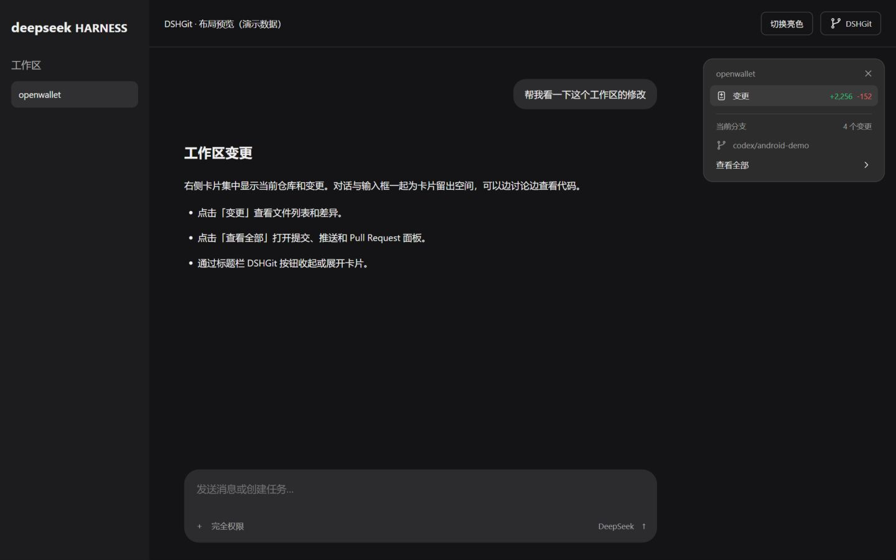
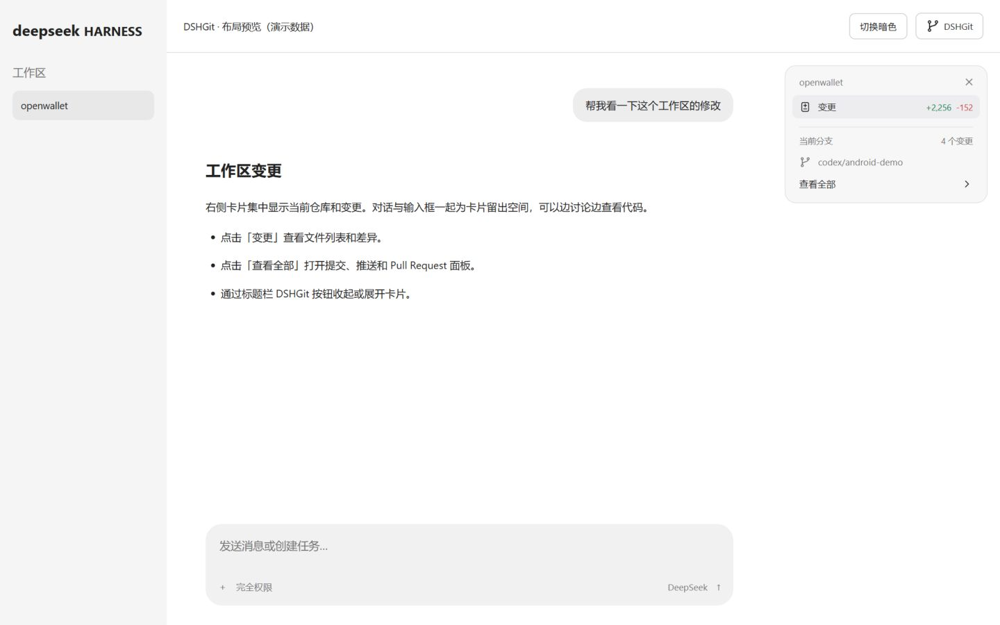

# DSHGit

> [!WARNING]
> **安全升级要求：本次 fsmonitor 漏洞的最低安全修复版本为 `0.2.1`。使用旧版的用户必须升级至 `0.2.1` 或更高版本，升级前停止使用旧版 DSHGit。**
> 攻击者若能控制工作区生效的 Git 配置，旧版的状态扫描可能执行 `core.fsmonitor` 指定的程序；含自动预热的版本无需打开面板即可触发。普通远程克隆本身不会复制对方的 `.git/config`。
> `0.2.1` 已统一禁用 Git fsmonitor，并取消启动和创建会话时的自动预热。修复详情见 [PR #14](https://github.com/Alpaca233114514/better-dsh/pull/14)。此版本号指 **DSHGit 插件**，不是 DSH 宿主版本。

`0.2.0`：提交弹层以整个窗口居中，宽 380px，采用紧凑布局与半透明毛玻璃；新分支默认前缀为 `DSH/`，可编辑或清空，保存在当前客户端。差异按文件类型显示语法高亮，保留新旧行号和增删背景，支持 Python、JS/TS、Shell、PowerShell、JSON/YAML、Kotlin 等常见语言。未知类型或超过 300 KB 的差异保留纯文本显示。

> 2026-10-25：按 **DSH 0.2.x 系列**兼容，后续 rc、正式版与补丁版不再逐个添加版本号；原有最低版本和旧版例外保留。详见 [系列兼容说明](../docs/dsh-series-compatibility.md)。

当前版本已适配 **DSH 0.2.1-rc.2**，开发依赖锁定到该版本。2026-10-18 已完成本地构建与接口测试；真实桌面交互由用户手动验收。下文较早版本的验证记录保留为历史证据。

面向 **DeepSeek Harness 0.2.1-rc.2** 的原生 Git 面板插件。Web 与桌面 Web 客户端共用同一界面；插件不依赖本仓库的其他组件。

会话右上方默认显示紧凑的 **DSHGit 工作区卡片**，标题栏的 **DSHGit** 按钮可收起或展开。会话容器宽度达到 900px 时，右侧预留 328px，消息和输入框一起左移；窄窗口自动收起，可手动展开为悬浮卡片，不压缩正文。卡片保持原位；点击「变更」或「查看全部」在 DSH 原生右侧栏打开 **DSHGit** 标签页，不再弹出模态窗口。右侧栏「开始」页也提供 DSHGit 入口，与工作区文件、终端和浏览器并列：

- **变更详情**：侧栏仅保留一条紧凑工具栏，显示变更统计、当前分支及操作图标；打开时直接显示首个文件差异。文件夹按钮展开已暂存和未暂存列表，支持逐文件暂存、取消暂存；差异带新旧行号与增删背景色。会话卡片保留原位，详情内不重复展示。
- **提交与推送**：分支切换、创建功能分支、提交信息、包含未暂存更改选项，以及提交、提交并推送、创建 Pull Request、单独推送四个入口。提交信息留空时，由当前会话模型根据本次暂存差异生成，再执行提交。单独推送已有提交不调用模型。
- **后台操作与通知**：选择提交、提交并推送或推送后立即收起菜单；后台执行期间阻止重复操作。关闭标签页或切换会话不取消已发出的操作，结果由页面顶部悬浮通知显示。成功通知 6 秒后消失；失败及“提交成功但推送失败”保留到手动关闭。
- **Pull Request**：查询当前分支已有的开放 PR 并打开；创建界面包含目标分支、标题、描述和草稿开关。标题或描述留空时，由当前会话模型补全，已填内容保持不变。创建前检查当前 HEAD 已推送到 origin。
- **主题一致性**：颜色直接引用 DSH 的 `--dsw-alias-*` 变量，随宿主亮色、暗色和跟随系统设置自动切换；不另存独立主题。独立开发预览使用系统颜色作为后备。
- **快捷键**：提交菜单内 `Ctrl/⌘+Enter` 提交，`Ctrl/⌘+Shift+Enter` 提交并推送；`Esc` 关闭提交菜单；标签页使用原生侧边栏的关闭与切换操作。入口还提供 HTML `accesskey=g`，具体修饰键由浏览器/操作系统决定。

## 安装

**安全升级：** 先获取包含修复的最新仓库或 `0.2.1` 及以上版本安装包，再使用目标 DSH 运行时的原生插件管理命令重新安装。通过 `file:...tgz` 安装的插件不会随仓库更新，必须改用修复版本的安装包。安装后完整退出并重启目标 DSH，使新的 Host 代码生效；刷新页面不能替代重启。

变更视图只读取本地 Git，打开 PR 视图才访问 GitHub。HTTPS 远程操作优先使用宿主已有代理环境。在 Windows 上，未配置代理环境变量时，插件通过当前沙箱内的 Windows PowerShell 查询目标地址适用的系统代理。也可在启动 DSH 前设置 `DSH_GIT_PROXY`，给插件的 HTTPS 命令单独指定代理，例如 `$env:DSH_GIT_PROXY = 'http://127.0.0.1:7890'`（端口按实际配置填写）。Git 自身的代理配置和 SSH 远程仍按 Git 的规则处理。

要求 Node.js **24+**、Git，以及 DSH 0.2.1-alpha.2。推送沿用宿主的 Git/SSH 凭证；PR 功能另需安装 [GitHub CLI](https://cli.github.com/) 并在宿主上完成 `gh auth login`。当前 PR 支持 `github.com` 的 `origin`，不支持其他托管平台及企业域名。

仓库包含可直接安装的 `lib/` 构建产物。将路径替换为实际绝对路径：

```powershell
dsh plugin --profile web add "link:C:/path/to/better-dsh/DSHGit" --ignore-scripts
```

桌面版请完整退出后，用桌面运行时附带的 `dsh` 命令安装，将 `web` 改为 `desktop`，然后重启。安装完成后在有工作区的会话标题栏打开 **DSHGit**。

## 操作约定

`main/master` 禁止提交、推送和创建 PR；可在提交菜单创建功能分支。插件不提供丢弃文件、强推、改写历史或合并 PR 操作。取消暂存只修改索引，不删除工作区文件。

“包含未暂存的更改”默认勾选，会暂存整个仓库下所有未忽略的新增、修改和删除；取消勾选时只提交现有暂存区。留空字段的生成使用 DSH 当前会话选择的模型和现有凭证，把相关差异发送给该模型提供方；已填写的字段不改写。模型调用仅生成文本，不具备工具执行能力，也不向当前对话插入消息。

PR 自动说明会先读取 origin 上目标分支，再总结该分支与当前提交的差异和提交记录。输入过长时会截断并明确标注；无测试执行证据时不声称测试通过。模型失败、响应不完整或生成期间 Git 状态变化时停止后续写入，可重试或手动填写；已暂存内容保留。

行数是已跟踪文件暂存区与工作区的 `numstat` 之和；新文件暂存后计入，二进制文件不计文本行数。同一文件在两处有修改时分别计数。上游领先/落后数来自本地远程引用，状态刷新不自动 fetch；仅 PR 自动说明读取目标分支时执行 fetch。

Git 和 gh 通过宿主 `subprocess` 服务以参数数组执行；沿用当前会话 `sandboxPolicy` 与 `sandbox.confine`，不改变权限或自动提升。只读会话禁用写操作，沙箱拒绝直接显示错误。所有 Git 调用通过命令行空值覆盖 `core.fsmonitor`，禁用仓库、包含文件和环境配置指定的文件监视器，不修改用户 Git 配置。提交失败时保留索引和文件；提交成功但推送失败会明确提示，可单独重试推送。

首次客户端请求状态或订阅变更时建立内存快照；启动、创建会话及切换沙箱模式本身不运行 Git。同一工作区、相同沙箱策略的会话共享缓存，界面读取缓存不启动 Git。窗口隐藏、卡片收起或 DSHGit 标签页隐藏时释放对应客户端订阅，宿主继续维护缓存；最后一个会话释放或插件卸载时关闭监听。缓存仅保存在内存中，不写磁盘，也不保留历史快照。每分钟清理一次：无客户端订阅且无执行中任务的缓存，闲置 10 分钟后淘汰；闲置缓存最多保留 16 个，按最近使用时间淘汰。正在使用的缓存不被中断。淘汰会关闭监听并清除文件状态和路径索引，下次访问再重建。动态学习的忽略路径最多 4096 条，每 10 分钟按需清空。

普通文件变更按路径合并（250ms），只查询这些路径的状态、暂存区与工作区行数，再替换对应文件的缓存项。被忽略的日志和缓存目录不触发状态扫描；新出现的未知路径先批量检查忽略规则。分支、索引、Git 配置等元数据变化、忽略或属性规则变化，以及跨路径重命名等情况做全量校正；分支列表和查看差异不再先做全仓库状态扫描。Git 写操作仍重新校验当前状态和权限。

客户端断连按 1–30 秒退避重连，恢复时直接读取当前缓存；手动刷新会强制全量校正。原生监听依赖操作系统和文件系统，网络盘漏事件或仓库外全局 Git 配置变化可用手动刷新校正。测试覆盖增量与全量结果对照、空闲零查询、原生监听、按需缓存共享及流式输出重渲染。

## 开发与验证

```powershell
npm ci --ignore-scripts
npm run typecheck
npm run build
npm test
npm run preview
```

`preview` 仅在 `127.0.0.1:4318` 启动带会话布局的演示数据页面，验证保留卡片、侧边栏详情、宽窄布局、菜单即时关闭、顶部通知、PR 表单与亮暗主题，不执行 Git 操作。预览的侧边栏外壳是演示；正式插件通过宿主的 sidebarRightTabs 注册原生标签页和开始页入口。可通过 `DSHGIT_PREVIEW_PORT` 更换端口。

卡片挂载到入口所在会话的原生 `data-conversation-content` 容器旁，卸载时清理布局标记；找不到宿主标记时退回悬浮卡片。卡片布局适配基于当前 DSH DOM 标记，宿主升级后需要复查。详情页使用官方 `sidebar.right.pane.tab` 扩展位，不修改原生开始页。

历史卡片布局预览（演示数据；下图不代表本次新增侧边栏详情）：





测试使用独立临时仓库，涵盖真实 Git 状态、差异、暂存、取消暂存、提交与本地 bare remote 推送，以及 React 操作、快捷键和变更订阅生命周期。PR 的 gh 调用使用受控替身，不在测试中创建真实 GitHub PR。测试仓库保留在根目录 `.cache/dshgit-*` 便于检查。

源码中 Host 与 Client 的 Typert codec 共用，`lib/` 由构建生成。兼容验证基于 npm 发布的 DSH 0.2.1-alpha.2 接口；独立预览和测试不代表已经在用户安装的桌面运行时完成验收。

## 许可

原创实现遵循仓库的 Apache-2.0，见 [LICENSE](LICENSE)。实现前检索了 [dsh-git-nexus](https://github.com/JFWaskin/dsh-git-nexus) 与 DSH 官方插件接口；未复用这些项目的源码。

GitHub 标识复用自 [Primer Octicons](https://github.com/primer/octicons)，遵循 MIT 许可证；许可全文见 [OCTICONS-LICENSE.txt](docs/OCTICONS-LICENSE.txt)。

语法高亮使用 [lowlight](https://github.com/wooorm/lowlight)（MIT）与 [highlight.js](https://github.com/highlightjs/highlight.js)（BSD-3-Clause），随客户端打包；第三方许可见 [SYNTAX-LICENSES.txt](docs/SYNTAX-LICENSES.txt)。

工作区干净时，提交菜单仅保留“推送”和“创建 Pull Request”（已有 PR 时为“查看 Pull Request”），隐藏提交信息和包含未暂存更改选项。有未提交更改时显示提交操作；操作执行期间禁止重复触发。
