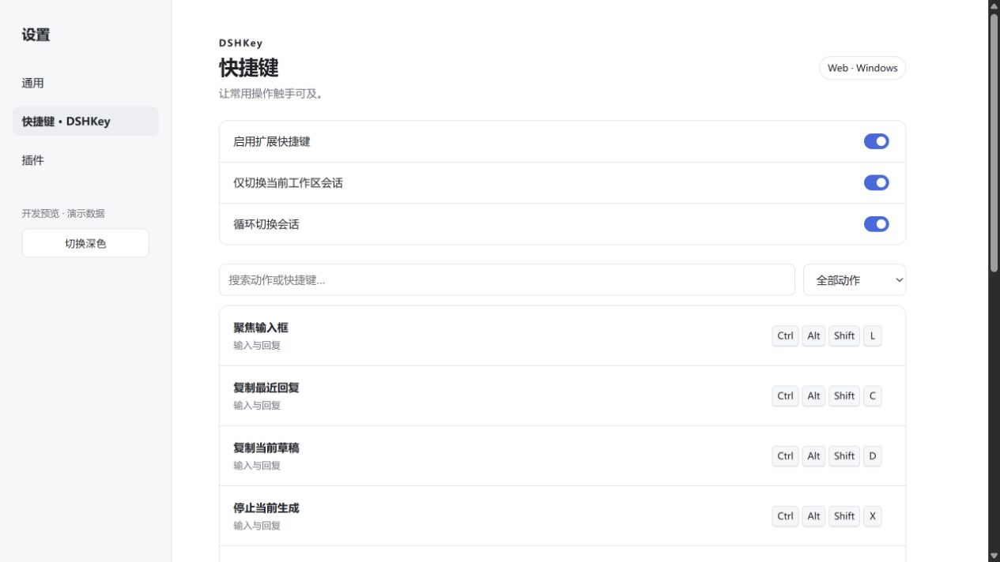

# DSHKey

> 2026-10-25：按 **DSH 0.2.x 系列**兼容，后续 rc、正式版与补丁版不再逐个添加版本号；原有最低版本和旧版例外保留。详见 [系列兼容说明](../docs/dsh-series-compatibility.md)。

当前版本已适配 **DSH 0.2.1-rc.2**，开发依赖锁定到该版本。2026-10-18 已完成本地构建与接口测试；真实桌面交互由用户手动验收。下文较早版本的验证记录保留为历史证据。

面向 **DeepSeek Harness 0.2.1-rc.2** 的原生快捷键扩展。安装后在 **设置 → 快捷键 · DSHKey** 中管理键位。



## 功能

- 9 个扩展动作：聚焦输入框、复制最近回复、复制草稿、停止生成、前后切换会话、返回聊天、置顶和取消置顶。
- 同页显示宿主已注册的新建、搜索、重命名、分叉、归档等动作；实际列表取决于当前安装的 DSH 功能。
- 搜索动作、筛选扩展或已修改项；点击键位录制组合键，再保存。支持解除绑定、单项恢复默认。
- 保存前检查与原生动作、扩展动作、固定按键的冲突；输入法组合输入和长按不会重复执行动作。
- 会话切换默认限定当前工作区并循环，跳过归档、子代理和未选中的空白会话。顺序使用 Host 会话目录顺序。
- 跟随宿主主题；Enter、Shift+Enter、Esc 等固定按键作为只读参考展示。

## 默认快捷键

Windows 使用 **Ctrl + Alt + Shift**，macOS 使用 **⌘ + Option + Shift**，再加下列按键。键位可自行修改。

| 按键 | 动作 |
| --- | --- |
| L | 聚焦输入框 |
| C | 复制最近已结束回复的正文 |
| D | 复制当前草稿 |
| X | 停止当前生成 |
| [ / ] | 上一个 / 下一个会话 |
| J | 返回当前聊天 |
| P | 置顶当前会话 |
| U | 取消当前会话置顶 |

Linux 的官方快捷键规则更严格，因此扩展动作默认不绑定，需在设置里选择宿主接受的组合。所有平台仍受系统、浏览器对按键的实际投递限制。

## 安装

要求 Node.js 24+，使用 DSH **0.2.0-rc.2 或 0.2.1-alpha.2** 对应运行时。仓库提供 `lib/` 构建产物，可直接安装；将路径替换为实际位置：

```powershell
dsh plugin --profile web add "link:C:/path/to/better-dsh/DSHKey" --ignore-scripts
```

桌面端使用桌面版附带的 `dsh` 命令，将 profile 改为 `desktop`；完整退出桌面后安装，再重新打开。旧版 0.1 的快捷键服务接口不适用。

键位通过 DSH 原生 `shortcuts` 服务持久化：Web 保存于当前浏览器的站点存储，桌面端交给官方主进程存储。不同设备 / 平台分别保存。插件的启用、工作区限制和循环切换选项由 **Host settings** 保存，带版本检查；远程连接若不开放该设置命名空间，扩展动作保持停用。

插件启用开关控制 DSHKey 的扩展动作，不改变原生动作。要释放某个键位，可点开该动作后选择「解除绑定」。卸载后原生存储保留其键位记录，重新安装可以继续使用。

## 后端与执行链路

- `src/index.ts`：导出经过 Schema 校验的 Host 配置，注册到 DSH 原生 settings 服务；客户端通过 `configForms.mutate` 保存，沿用宿主的只读限制、持久化和版本冲突处理。
- `src/actions.ts`：统一动作注册与执行。停止生成调用当前会话的 `session.cancel()`；置顶操作调用 `uiWorkspace.pinSession/unpinSession()`，由原生服务完成 Host RPC。
- 异步动作固定捕获按键时的会话目标；同一会话的置顶 / 取消置顶互斥，失败显示在该会话的输入区通知里。弹窗与终端输入区不触发扩展动作。
- 复制回复读取 Chat 的 `assistant-step` 数据，仅取已结束或中断回复中的正文，跳过推理和工具内容。草稿复制保留原输入；插件不会自动发送消息或调用模型。
- `src/settings.tsx`：原生设置侧栏页面；键位保存使用 `shortcuts.edit` 的版本检查和冲突验证。失败保留编辑内容。

## 开发与验证

```powershell
npm --prefix DSHKey ci --ignore-scripts
npm --prefix DSHKey run typecheck
npm --prefix DSHKey run build
npm --prefix DSHKey test
npm --prefix DSHKey run preview
```

开发预览使用独立演示数据，不连接用户账号或日常 DSH 配置，默认地址为 `http://127.0.0.1:4322`。其中的设置修改仅在预览进程页面中演示。

可另外传入已取得的官方源码及其运行时依赖目录，验证原生注册器和持久化实现：

```powershell
node DSHKey/test/upstream.mjs C:/path/to/deepseek-harness C:/path/to/dsh-runtime/node_modules
```

当前验证：15 项自动化测试、TypeScript 检查、生产构建通过；官方注册器的 Web / Desktop × Windows / macOS / Linux 六组合通过。浏览器预览验证了录制、保存、恢复默认和亮暗主题。2026-10-17 已在正式 Windows 桌面版 0.2.0-rc.2 完成安装、设置页加载和 Host 开关保存验证；自动化键盘事件缺少物理键码，**实体快捷键触发及重启后改键保留仍待核验**。详见 [桌面实测记录](docs/desktop-verification-20261017.md) 与 [兼容性记录](docs/compatibility.md)。未执行真实模型生成。

原创代码采用 [Apache License 2.0](LICENSE)。
