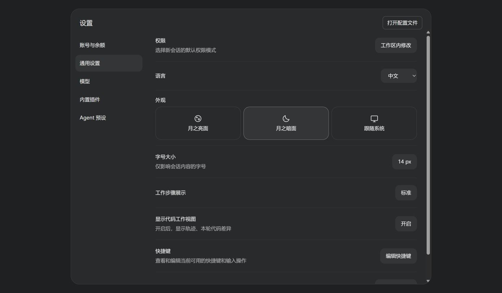
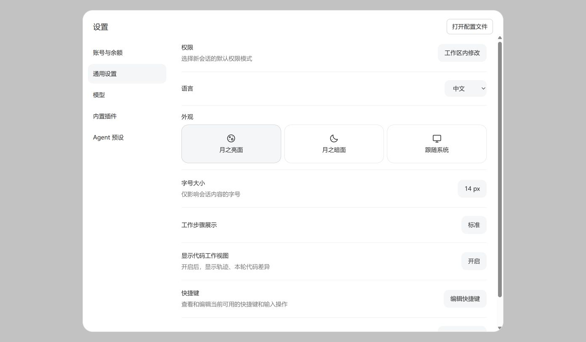

# 本地验证记录

日期：2026-10-16。

- `npm run build`：通过，生成 DSH 原生 `window.__ModuleLoader__` 客户端入口。
- `npm test`：2 项通过、0 跳过。直接加载交付的客户端 bundle，验证三种模式写入、
  外部主题变化、中文 / 英文、系统偏好选中、卸载清理和重新启用。
- 统一设置集成测试：读取本机官方 DSH `0.2.1-alpha.2` 源码的 `SlotCore` 与
  `GeneralSection`，加载实际交付插件。外观卡片位于语言、字号之间，只显示一组；
  插件没有注册独立设置页面、导航或对话框，移除后恢复原生外观行。
- `npm pack --dry-run --ignore-scripts`：确认运行入口、bundle patch、说明及双许可证随包交付。
- Chrome 本机预览：亮面 / 暗面点击、英文切换、Tab 焦点、Enter 切换均通过。
  390 × 844 窄屏下卡片宽 342px、高 91px，三项垂直排列，无横向溢出。

统一设置面板的深色与浅色预览（周边行为使用布局示例）：

之前的 `preview-dark.png` / `preview-light.png` 为早期组件隔离测试截图，
不代表插件会新增独立界面。当前预览只在统一设置布局中展示外观行。

预览使用模拟主题服务和示例色值，只验证组件显示与交互。实际 DSH Host 的设置落盘、
桌面安装和重启恢复尚未实测；插件直接调用宿主 `theme.setTheme()`，没有自己的偏好存储。
